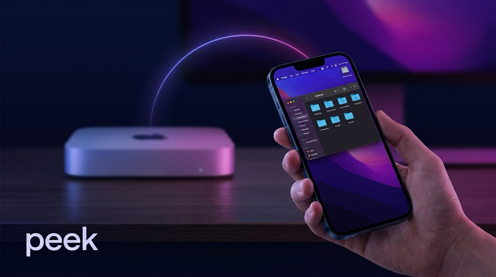

<p align="center">
  
</p>

# peek

**See and control your Mac from your iPhone or iPad** — the way macOS Screen
Sharing does it, as a native iOS app. Macs with Screen Sharing turned on show up
by themselves; sign in with your Mac account and the screen is in your hand.

peek speaks VNC (RFB), so it also connects to any other VNC server — a Linux box,
a Raspberry Pi, a Windows machine running TightVNC — but a Mac in the other room
is what it was built for.

[](https://github.com/johnpc/peek/actions/workflows/quality-gates.yml)


## Features

| | Status |
|---|---|
| Nearby Macs appear automatically (Bonjour `_rfb._tcp`) | ✅ |
| Save computers by name/address/port; edit, delete | ✅ |
| Apple Remote Desktop sign-in (Mac account + password) and classic VNC passwords | ✅ |
| Remember passwords in the iOS keychain | ✅ |
| Live remote screen, pinch to zoom, pinch-and-move to pan | ✅ |
| Tap = click, double tap, two-finger tap = right click, long-press-and-drag, two-finger scroll | ✅ |
| On-screen keyboard with sticky ⌘ ⌥ ⌃ ⇧ and esc / tab / return / delete / arrows | ✅ |
| Color depth (8/16/24-bit) and shared-screen settings | ✅ |
| Clipboard sync | ⬜ |
| Hardware keyboard & trackpad on iPad | ⬜ |
| Wake-on-LAN | ⬜ |

## Install

- **TestFlight:** coming with the first build from CI.
- **Requires** iOS 26 or later.

## How to use it

1. On the Mac: System Settings → General → Sharing → turn on **Screen Sharing**.
2. Open peek on the same Wi-Fi. The Mac appears under **Nearby** — tap it, save.
3. Tap the computer, enter your Mac user name and password, connect.

## How it works

peek is a **SwiftUI** app (iOS 26+). The remote-desktop engine is
[RoyalVNCKit](https://github.com/royalapplications/royalvnc) (MIT), a Swift
implementation of the RFB protocol with Apple Remote Desktop authentication and
the Tight / ZRLE / Zlib / Hextile encodings. Everything the app does with it goes
through one small `RemoteDesktop` protocol, so the whole UI is tested against a
mock desktop that paints its own screen and records every click and key.

- **Discovery** browses Bonjour for `_rfb._tcp` with Network.framework and
  resolves each Mac to an address.
- **Sessions** throttle framebuffer updates to ~30 fps, translate touch gestures
  into framebuffer-pixel mouse events, and keep tapped modifiers held until the
  next key — the touch equivalent of holding ⌘.
- **Nothing leaves the phone** except the VNC connection. No accounts, no
  analytics. Passwords live in the device keychain.

## Where the data comes from

There is no backend. The only data is what you type (computer names and
addresses, stored in the app) and what your Mac streams to you over your network.

## Development

Quality gates (every file ≤ 100 lines, ≥ 80% coverage, CRAP ≤ 15, Gherkin
acceptance tests) run on every commit and in CI on a self-hosted Mac mini. See
[`CLAUDE.md`](CLAUDE.md) for the charter and
[`AcceptanceTests.md`](AcceptanceTests.md) for the spec workflow.

```bash
bash scripts/quality.sh
```

## License

MIT
